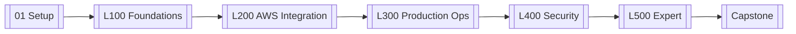

# EKS Lab 2026 — Home

> [!info] How to use this notebook
> Open the **repo root** (`EKS-lab-2026/`) as your Obsidian vault, so links to code files work too.
> Work through the notes in order and tick boxes as you go. Each level note has a
> **My notes** section at the bottom for findings, screenshots and answers to the quiz.

## Map of the lab

| # | Note | Sessions | Status |
|---|---|---|---|
| 0 | [[01 Setup (one-time)]] | 1 | ⬜ |
| 1 | [[L100 Foundations]] | 2 | ⬜ |
| 2 | [[L200 AWS Integration]] | 4 | ⬜ |
| 3 | [[L300 Production Ops]] | 6 | ⬜ |
| 4 | [[L400 Security]] | 5 | ⬜ |
| 5 | [[L500 Expert]] | 6 + capstone | ⬜ |

Change ⬜ to ✅ when `make verify LEVEL=xxx` is all green.

## Always-open references
- [[02 Daily Loop]]: start and stop every session the same way
- [[90 Troubleshooting]]: symptom → cause → fix
- [[91 Glossary]]
- [[92 Cost Log]]: track what each session cost

## Repo landmarks
| Path                       | What                                    |
| -------------------------- | --------------------------------------- |
| `Makefile`                 | `make up / verify / down / lint / cost` |
| `lab.env`                  | your settings (gitignored)              |
| `terraform/envs/lab/`      | the cluster stack                       |
| `levels/LXXX-*/lab.tfvars` | which features each level turns on      |
| `k8s/apps/shop/`           | sample app manifests                    |
| `gitops/`                  | Argo CD ApplicationSets (L300+)         |
| `scripts/versions.env`     | pinned chart versions                   |

> [!warning] Golden rule
> **Never end a session without `make down`.** A forgotten cluster costs about $5/day, and orphaned load balancers or NAT gateways keep billing even after the cluster is gone.
