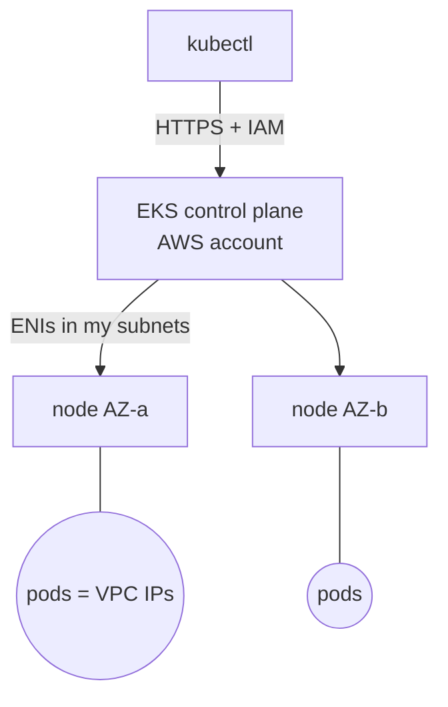

# L100 Foundations

[[00 EKS Lab Home]] · next → [[L200 AWS Integration]] · full guide: [L100 README](../levels/L100-foundations/README.md)

> [!abstract] Goal
> Understand what EKS is, create a cluster with eksctl and then with Terraform, and deploy, scale, expose and debug the shop.

## Concepts to be able to explain
- [ ] What AWS runs (the control plane) and what I run (the data plane)
- [ ] Managed node groups vs Fargate vs **EKS Auto Mode**
- [ ] VPC CNI: pods get VPC IPs
- [ ] Access entries vs access policies (and why `aws-auth` is deprecated)
- [ ] Standard vs extended support (cost)



## Session 1 — eksctl (≈ 60 min)
- [x] Create the throwaway cluster
  ```bash
  eksctl create cluster -f levels/L100-foundations/eksctl-cluster.yaml
  ```
- [ ] Look at the two CloudFormation stacks eksctl created
- [x] Explore the empty cluster
  ```bash
  kubectl get nodes -o wide
  kubectl get pods -A
  kubectl get ds -n kube-system
  ```
- [x] Check who I am to Kubernetes
  ```bash
  kubectl auth whoami
  aws eks list-access-entries --cluster-name eks-lab-first
  ```
- [ ] *(optional)* Try an Auto Mode cluster and note 3 things I no longer control
- [x] Delete the cluster
  ```bash
  eksctl delete cluster -f levels/L100-foundations/eksctl-cluster.yaml --disable-nodegroup-eviction
  ```

## Session 2 — Terraform + first app (≈ 90 min)
- [ ] Read `terraform/envs/lab/main.tf`, `modules/vpc`, `modules/eks`
  - [ ] Why are there public, private *and* intra subnets?
  - [ ] What do the `kubernetes.io/role/elb` tags do?
  - [ ] What does `http_put_response_hop_limit = 1` prevent?
- [ ] Plan and apply
  ```bash
  make plan LEVEL=100
  make up LEVEL=100
  ```
- [ ] Deploy the shop
  ```bash
  scripts/deploy-shop.sh l100
  ```
- [ ] Open the shop in a browser via the Classic LB hostname
  ```bash
  kubectl -n shop get svc shop-web
  ```
- [ ] Scale, roll out, look at history, roll back
  ```bash
  kubectl -n shop scale deploy shop-web --replicas=4
  kubectl -n shop set env deploy/shop-api APP_VERSION=v2
  kubectl -n shop rollout history deploy/shop-api
  kubectl -n shop rollout undo deploy/shop-api
  ```
- [ ] Logs, exec, debug, events
  ```bash
  stern -n shop shop-
  kubectl debug ...
  kubectl get events -n shop
  ```
- [ ] Readiness drill: turn readiness off on one pod and watch it leave the EndpointSlice

## 🔧 Break it (tick when diagnosed *and* fixed)
- [ ] ImagePullBackOff
- [ ] Pending (Insufficient cpu)
- [ ] OOMKilled
- [ ] CrashLoopBackOff
- [ ] Web shows an API error (no endpoints)

## Finish
- [x] Run the checks
  ```bash
  make verify LEVEL=100
  ```
  Result: `__/__`
- [x] Tear down and check for leftovers
  ```bash
  make down
  make nuke-check
  ```

## Quiz (answer in my own words)
1. Which control-plane components are invisible in `kube-system`, and why?
   -
2. Where does a pod IP come from, and what limits pods per node?
   -
3. Access entry vs access policy?
   -
4. Managed node groups vs Auto Mode: one reason for each?
   -
5. A readiness probe fails. Does the container restart? What happens to traffic?
   -

## My notes
-

## Session log
| Date | Session | Duration | Cost | Notes |
|---|---|---|---|---|
| | 1 | | | |
| | 2 | | | |
