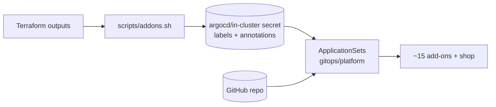

# L300 Production Ops

← [[L200 AWS Integration]] · [[00 EKS Lab Home]] · next → [[L400 Security]] · full guide: [L300 README](../levels/L300-production-ops/README.md)

> [!abstract] Goal
> Everything comes from Git. Capacity follows demand, deploys are progressive, and metrics, logs and traces feed SLO alerts.

## One-time for L300+
- [ ] Set `GITHUB_REPO` in `lab.env`, then re-run `make bootstrap` to create the OIDC CI role
- [ ] Render the GitOps overlay and push it
  ```bash
  make images
  scripts/gitops-init.sh
  git add -A && git commit -m "gitops: render lab values" && git push
  ```
- [ ] Add GitHub repo variables `AWS_REGION` and `AWS_ACCOUNT_ID`

> [!warning] Public repo
> `gitops-init.sh` writes your AWS account ID into the overlay. That's not a secret, but it will be public.



Start every session with:
```bash
make up LEVEL=300
kubectl -n argocd get applications -w
export ALB=$(kubectl -n shop get ingress shop -o jsonpath='{.status.loadBalancer.ingress[0].hostname}')
```

## Session 1 — Autoscaling
- [ ] Inspect the Karpenter objects
  ```bash
  kubectl get nodepool,ec2nodeclass
  ```
  Read the requirements and the disruption policy.
- [ ] Load test
  ```bash
  kubectl apply -f k8s/tools/load-test.yaml
  ```
  Watch the HPA scale up, Karpenter launch nodes, and then consolidate them away.
- [ ] KEDA: flood the queue with 300 orders and watch shop-worker scale on queue depth
- [ ] VPA recommendation for shop-web (updateMode Off)
- [ ] Exercise: an on-demand, tainted `on-demand-critical` NodePool for shop-api

## Session 2 — GitOps + Rollouts
- [ ] Argo CD UI and CLI login
- [ ] Drift: scale manually and watch self-heal undo it
- [ ] Change config through Git
- [ ] Upgrade an add-on by bumping `targetRevision`, then roll back with `git revert`
- [ ] Good canary: `APP_VERSION=v2` steps 10 → 30 → 60 → 100
- [ ] Bad canary: `ERROR_RATE=0.3`. The analysis fails and the rollout aborts automatically.

## Session 3 — CI (OIDC, no keys)
- [ ] Push a change to `apps/shop/**` and follow it with `gh run watch`
- [ ] The tag bump commit triggers an Argo sync, which starts a rollout
- [ ] Find which trust condition limits which workflow can assume the role

## Session 4 — Observability
- [ ] Grafana: namespace dashboard for `shop`
- [ ] PromQL: request rate by route and status
- [ ] Tempo: a trace from web → api → SQS, and the service graph
- [ ] Logs Insights: application logs, plus *who deleted that pod?* from the audit log
- [ ] Part B: managed AMP scraper, scraper RBAC, Grafana SigV4 datasource

| Signal | Where |
|---|---|
| Metrics | Prometheus → AMP |
| Logs | CloudWatch (Container Insights add-on) |
| Traces | OTel Collector → Tempo |
| Audit | `/aws/eks/eks-lab/cluster` |

## Session 5 — SLOs & alerting
- [ ] Explain SLI, SLO, error budget and burn rate
- [ ] Inject errors with sustained traffic and watch `ShopApiErrorBudgetFastBurn` fire
- [ ] Exercise: a real Slack receiver via an ExternalSecret, set up through Git

## Session 6 — Secrets & resilience
- [ ] External Secrets: change the value in Secrets Manager and watch it sync
- [ ] Drain a node: the PDB is respected and pods stay spread across zones
- [ ] Hit the ResourceQuota and find where the error shows up
- [ ] Explain `services.loadbalancers: "0"`

## 🔧 Break it
- [ ] NodePool CPU limit reached
- [ ] Argo app OutOfSync
- [ ] No traces (collector down)
- [ ] KEDA AccessDenied
- [ ] Spot interruption via FIS

## Finish
- [ ] Run the checks
  ```bash
  make verify LEVEL=300
  ```
  Result: `__/__`
- [ ] Tear down
  ```bash
  make down
  ```

## Quiz
1. Why shouldn't Karpenter run on nodes it provisions?
   -
2. How do you stop HPA and KEDA fighting over one Deployment?
   -
3. `WhenEmptyOrUnderutilized` and a node with one small pod: what happens, and how do PDBs interact?
   -
4. The paging burn-rate rule, and why it uses two windows?
   -
5. How do you jump from a slow trace to its logs?
   -

## My notes
-

## Session log
| Date | Session | Duration | Cost | Notes |
|---|---|---|---|---|
| | 1 | | | |
| | 2 | | | |
| | 3 | | | |
| | 4 | | | |
| | 5 | | | |
| | 6 | | | |
